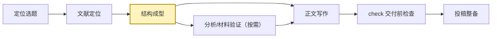

# User Journey Protocol（用户路径导航协议）

本协议规定 `paper-master-4ss` 面向研究者的进度导航规范，将内部模块状态映射为清晰可判断的论文写作阶段。本协议与 `master/routing-matrix.md`、`master/agent-orchestration.md`、guard 审计及 Rubric 评分协同使用，互不替代。

## 1. 六阶段论文路径

| 用户阶段 | 对应模块 | 阶段目标 | 完成标志 | 常见阻塞点 | 需用户提供 |
|---|---|---|---|---|---|
| 定位选题 | `design` | 确认工作模式（FRAME/STORM/DESIGN/FULL）与研究取向，形成研究问题或设计蓝图 | 已确认研究取向，产出对应模式报告与初步设计蓝图 | 取向未定、理论锚点不稳、方法不可行 | 研究兴趣、学科/期刊偏好、可用数据或材料 |
| 文献定位 | `lit` | 梳理文献谱系、争议脉络与研究空白，提出假设或理论对话框架 | 完成 `paper-registry.csv` 归档、检索记录、文献地图、`review-evidence.csv`、`gap-map.md` 及假设或理论对话包（综述成稿交由 `write`） | 文献范围过散、核心文献缺失、空白依据不足 | 检索范围、关键词偏好、是否启用 CNKI/Scholar/Zotero |
| 结构成型 | `outline` | 将问题、文献、材料与证据组织为可写作的论文结构 | 产出论文大纲、段落级写作蓝图、证据映射与缺口报告 | 章节顺序失衡、证据与论点错位、缺口未显式列出 | 论文类型、字数/期刊要求、已有材料路径 |
| 分析/材料验证 | `analysis`（按需） | 通过定量数据、访谈、文本或案例验证经验主张 | 产出分析计划、变量字典/编码方案、完整执行日志、表图及结果摘要 | 数据不可用、识别策略薄弱、结果不足以支撑声称 | 仅实证或混合设计标明 `analysis_required: true` 时需数据路径、变量角色与可用工具 |
| 正文写作 | `write` | 将结构与证据转化为符合体例的论文章节 | 产出分段草稿、修订稿、扫描报告与章节复核；综述任务交付 `05-writing/literature-review.md` | 论点不集中、材料嵌入生硬、表达偏离体例 | 草稿路径、目标风格、章节优先级、保留条款 |
| 投稿整备 | `check` + `submission` | 先由 `check` 完成跨阶段综合审稿检查，通过后由 `submission` 生成投稿包并核查格式与引文 | 产出审稿报告、问题矩阵、修订清单、Word 成稿、格式与引文检查报告、投稿清单及信函 | 论证或证据未闭环、Word 模板不匹配、引文信息缺失 | 目标期刊、模板文件、引文体例、投稿附件要求 |

## 2. 路线图文件维护

每次项目启动、继续推进或实质性执行完模块后，须同步更新 `paper-workspace/_index/paper-roadmap.md`，包含以下结构：

````markdown
# 论文路径图

## 当前定位
- 当前阶段:
- 本轮完成:
- 最重要的下一步:
- 暂时不建议做:

## 路径图


## 阶段建议
| 阶段 | 已有基础 | 缺口 | 建议动作 |
|---|---|---|---|

## 退回提醒
- 理论或框架问题 -> 退回 `design` / `lit`
- 材料或证据缺口 -> 退回 `outline` / `analysis`
- 章节结构与表达问题 -> 退回 `write`
````

Mermaid 块中的 `class <节点> current` 须根据实际状态替换为对应节点（`A`=定位选题、`B`=文献定位、`C`=结构成型、`D`=分析/材料验证、`E`=正文写作、`F`=投稿整备）。若阶段不明确，须依据 `_index/project-state.md`、`handoff-status.md`、`quality-score.json` 与已有产物推断最早阻断阶段并写明依据。

## 3. 最终回复导航

每次最终回复须附终端友好的纯文本路径图，并在图后用 2–4 句说明：
- 当前位置及本轮完成情况；
- 推荐下一步及推进理由；
- 须用户决定的事项（仅列会改变路径的选择）；
- 暂时不建议推进的事项及跳步风险。

路径图节点与 `【当前】` / `【当前?】` 标记格式以 `master/output-protocol.md` §6 为准。

## 4. 沟通规范

- 表述客观、具体、诚实，不空泛赞美，不夸大阶段性结果。
- 给出下一步建议时说明原因，不输出缺乏依据的指令清单。
- 明确保留不可声称内容、证据缺口与质量风险，并提供可操作的修补路径。
- 当项目进度混乱或阶段不清时，先依据现有产物定位，再给出最小可行下一步。
- 用户目标明确时，直接说明当前阶段、输出路径、检查状态与下一步。

## 5. 与其他索引的协同关系

- `_index/paper-roadmap.md` 提供面向研究者的进度与路线说明；
- `_index/project-state.md` 记录当前项目客观状态；
- `_index/handoff-status.md` 记录阶段交接状态与遗留风险；
- `_index/quality-score.md` / `.json` 记录 Rubric 评分与修复建议。

实质性模块执行完毕后，上述四项索引须保持同步。历史项目缺失 `paper-roadmap.md` 时不阻断当前交付，但在下一次启动或完成实质模块时补建。
